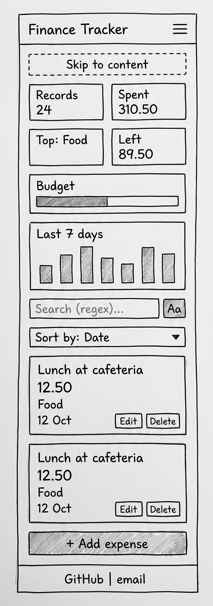
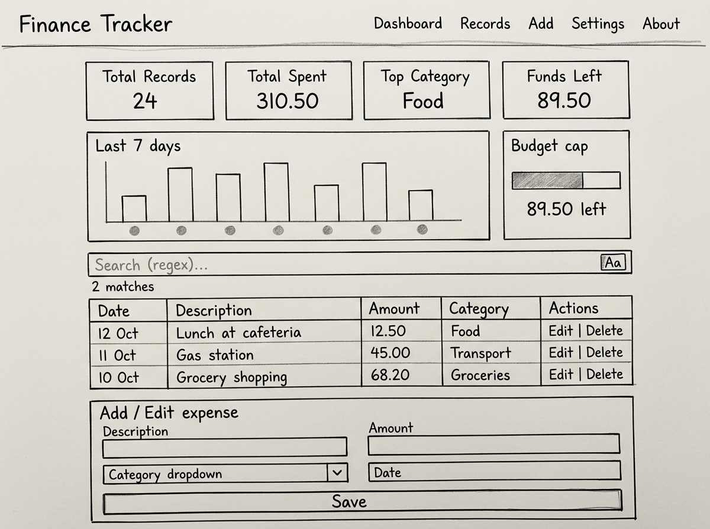

# Student Finance Tracker

**Theme:** Student Finance Tracker. A website where students log their expenses, search them with regular expressions, see their spending on a dashboard, set a budget, and keep their data between visits. Built with plain HTML, CSS and JavaScript (no frameworks).

**Live site:** https://taiwodotunx1.github.io/student-finance-tracker-v2/

**Demo video:** (link added in Step 32)

## Features

- Add expenses with live validation (errors appear as you type)
- Inline edit inside the row, with Esc to cancel; delete with confirmation
- Sort by date, description or amount, in both directions
- Live regex search with a case-insensitive toggle, safe handling of broken patterns, and `<mark>` highlights
- Dashboard: number of expenses, total spent, top category, and a 7-day bar chart
- Budget cap with a polite message when under and an assertive alert when over
- Data saved in localStorage and restored on reload; broken saved data is handled without crashing
- Export to JSON, and import JSON with full validation (nothing is loaded if any record is invalid)
- Show amounts in RWF, USD or NGN, with default exchange rates that can be edited
- Mobile-first layout: cards on phones, a table on tablet and laptop

## Running it locally

1. Clone the repository.
2. Open the folder in VS Code and start **Live Server** (right-click `index.html` → *Open with Live Server*).
3. To try it with sample data: Settings → **Import JSON** → choose `seed.json`.

The app uses ES modules, which do not run when `index.html` is opened by double-clicking. A local server such as Live Server is needed.

## Running the tests

With Live Server running, open `tests/tests.html`. It checks every regex rule against passing and failing examples and shows PASS/FAIL for each, with a total at the top (51 passed, 0 failed).

## Regex catalog

| Rule | Pattern | Passes | Fails |
|---|---|---|---|
| Description: no spaces at start or end | `/^\S(?:.*\S)?$/` | `Lunch`, `Bus to campus`, `A` | ` Lunch`, `Lunch `, empty |
| Amount: whole number or up to 2 decimals | `/^(0\|[1-9]\d*)(\.\d{1,2})?$/` | `0`, `12`, `12.5`, `12.50`, `99999.99` | `012`, `12.`, `12.555`, `-5`, `.50`, `abc` |
| Date: YYYY-MM-DD, plus a check that the date exists | `/^\d{4}-(0[1-9]\|1[0-2])-(0[1-9]\|[12]\d\|3[01])$/` | `2026-10-12`, `2024-02-29` | `2026-13-01`, `2026-1-5`, `12/10/2026`, `2026-02-31` |
| Category: letters, single spaces or hyphens | `/^[A-Za-z]+(?:[ -][A-Za-z]+)*$/` | `Food`, `Eating Out`, `Self-care` | `Food1`, ` Food`, `Food--x`, `Food  Out` |
| **Advanced (back-reference):** repeated word warning | `/\b(\w+)\s+\1\b/i` | flags `lunch lunch at cafe`, `Coffee coffee refill` | no warning for `the theme park` |
| **Advanced (lookahead):** exchange rate above 0 | `/^(?=.*[1-9])\d+(\.\d{1,6})?$/` | `1`, `0.85`, `0.00069` | `0`, `0.00`, `-1`, `abc` |

Notes:
- `\1` means "the same word that the first group matched", so it catches a word typed twice.
- `(?=.*[1-9])` looks ahead for at least one non-zero digit without consuming anything, so `0` and `0.00` fail.
- The guide's rate pattern allowed 4 decimals, but its own example `0.00069` has 5, so this app allows up to 6.
- Double spaces in a description are collapsed into one before saving.

### Search patterns to try

| Pattern | Finds |
|---|---|
| `^Bus` | descriptions starting with "Bus" |
| `coffee\|tea` (Aa on) | drinks |
| `\b(\w+)\s+\1\b` (Aa on) | repeated words |
| `\.(?!00)\d{2}` | amounts with real cents (amounts are shown as `2.00`, so `\.\d{2}\b` matches everything) |
| `[` or `(` | shows "Invalid pattern." without crashing |
| `a*` | empty matches are skipped, so the page never freezes |

## Keyboard map

| Key | Where | Action |
|---|---|---|
| Tab / Shift+Tab | anywhere | move to the next / previous control |
| Enter | "Skip to content" (first Tab) | jump past the menu to the main content |
| Enter | menu links | jump to that section |
| Enter | inside the Add or Settings form | save the form |
| ↓, then Enter | Category box | open the suggestions and pick one |
| Enter or Space | Aa button | turn case-insensitive search on / off |
| ↑ / ↓ | Sort by, Show amounts in | change the option |
| Digits, ↑ / ↓ | date boxes | type the date, or change the selected part |
| Enter | Edit button | edit that expense (focus moves to its Date) |
| Esc | while editing | cancel the edit (focus returns to Edit) |
| Enter | Save / Cancel in a row | save or cancel the edit |
| Enter, then Enter / Esc | Delete button | confirm or cancel the delete |
| Enter or Space | Import JSON | open the file picker |

## Accessibility notes

What was done:
- Landmarks (`header`, `nav`, `main`, `section`, `footer`), one `h1`, and headings in order
- A skip link, a visible 3px focus ring on every control, and logical Tab order
- Every input has a label; error messages are linked with `aria-describedby` and fields are marked with `aria-invalid`
- Live regions: `role="status"` for messages and match counts, `role="alert"` when over budget
- `aria-pressed` on the case toggle, `aria-sort` on the sorted column, and `aria-label`s that name the record on Edit/Delete buttons
- Each chart bar has a text label (e.g. "Thu 15 Oct: 2500.00 RWF") for screen readers
- Focus is moved on purpose: to the first field when editing, back to Edit after saving, to the search box after deleting
- Colour contrast of at least 4.5:1, and "Over budget" is shown in words, not only in red
- Animations are switched off when the device asks for reduced motion
- User text is always inserted with `textContent`, never `innerHTML`

How it was tested:
- A full keyboard-only run-through of every feature (the keyboard map above)
- Chrome Lighthouse accessibility audit (score 100 on mobile and desktop)
- Zoomed to 200% with nothing overlapping
- Layouts checked at 360px, 768px and 1024px

## Limitations

- Amounts are typed in RWF; other currencies are for display only.
- Categories are stored with a capital first letter, so "Eating Out" is saved as "Eating out".
- Data is stored in this browser only; it does not sync between devices.
- The 7-day chart always counts back from today.

## Planning (M1)

### Wireframes

Phone:


Tablet:


Laptop:


### Data model

Each expense is saved like this:

```json
{
  "id": "txn_0001",
  "description": "Lunch at cafeteria",
  "amount": 12.50,
  "category": "Food",
  "date": "2026-10-12",
  "createdAt": "2026-10-12T10:00:00Z",
  "updatedAt": "2026-10-12T10:00:00Z"
}
```

- `id`: unique, made by the app
- `amount`: stored in the base currency, up to 2 decimals
- `category`: typed freely (letters, spaces, hyphens); stored as "Food" style. Defaults are suggested
- `date`: YYYY-MM-DD

### Accessibility plan

- Skip-to-content link at the top of the page
- Proper landmarks: header, nav, main, section, footer
- Every input has a label; errors are linked to their field
- Visible focus outline on everything you can Tab to
- Status messages read out with `role="status"`; budget overage with `role="alert"`
- Text contrast of at least 4.5:1
- Everything works with the keyboard only (tested without a mouse)

### Decisions

- Amounts are stored in RWF (base currency). Users can switch the display to USD or NGN.
- Exchange rates come with sensible defaults, and users can edit them in Settings (no live API).
- The user sets their own budget cap in Settings; the app compares it with total spending.
- Records are edited inline, inside their own row.
- Categories are typed freely (letters, spaces and hyphens). The six defaults are suggested as you type.
- Categories are stored as "Food" style, so food = FOOD = Food.